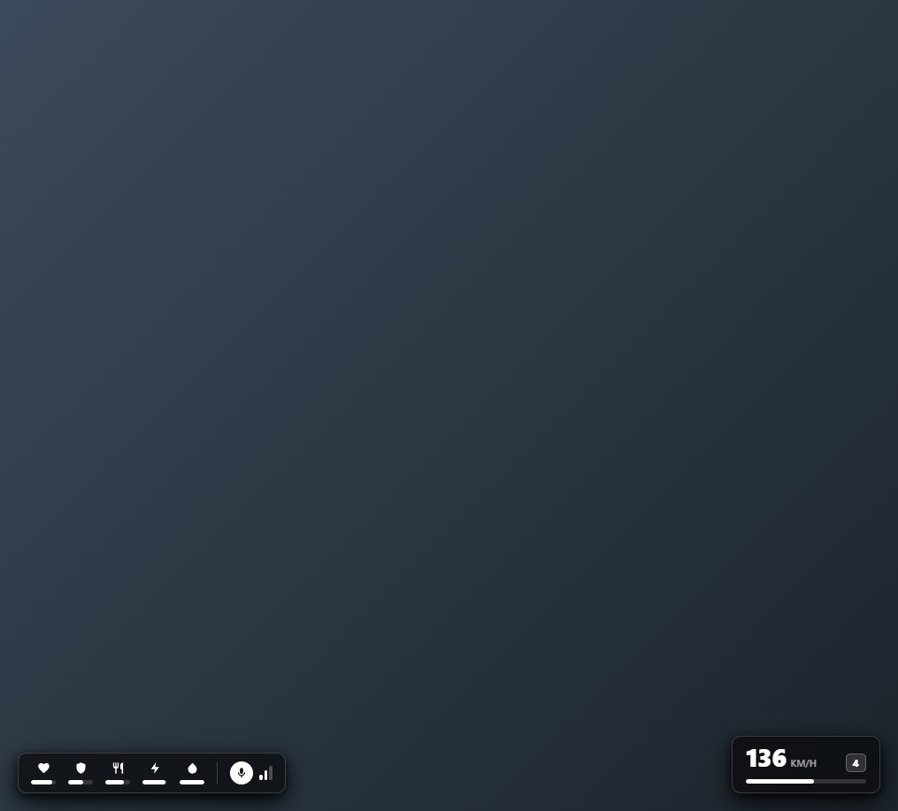
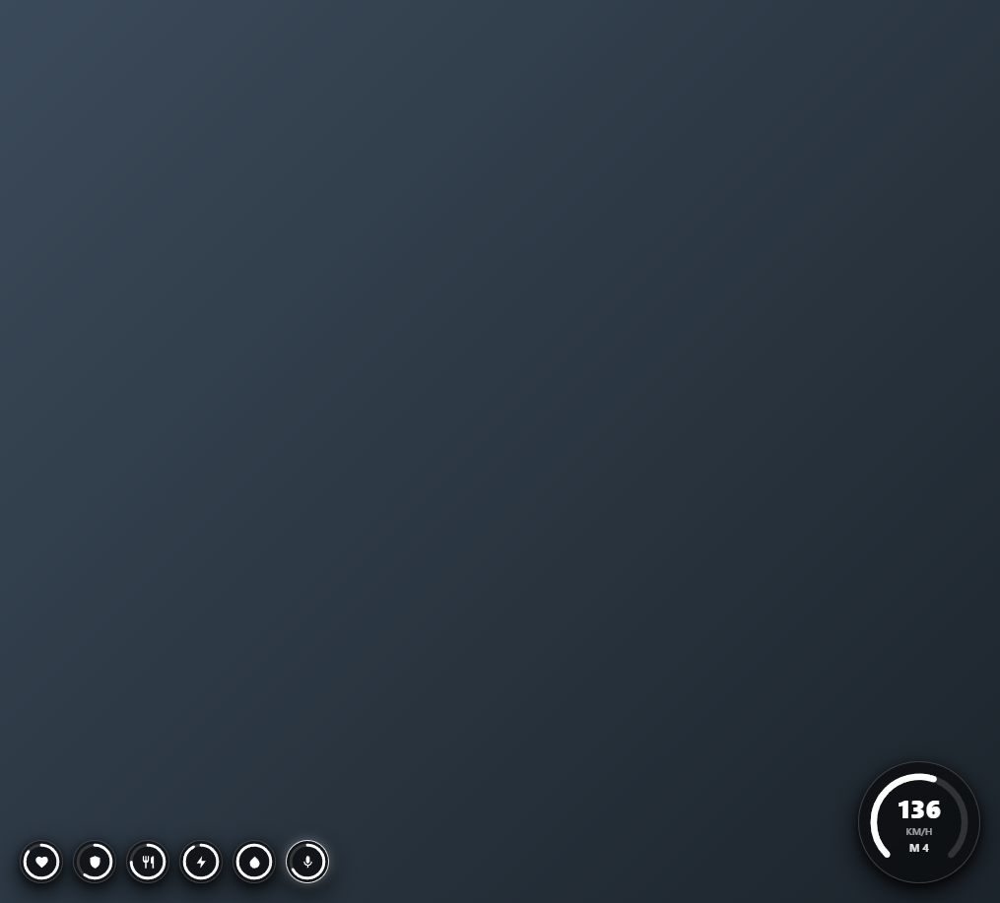
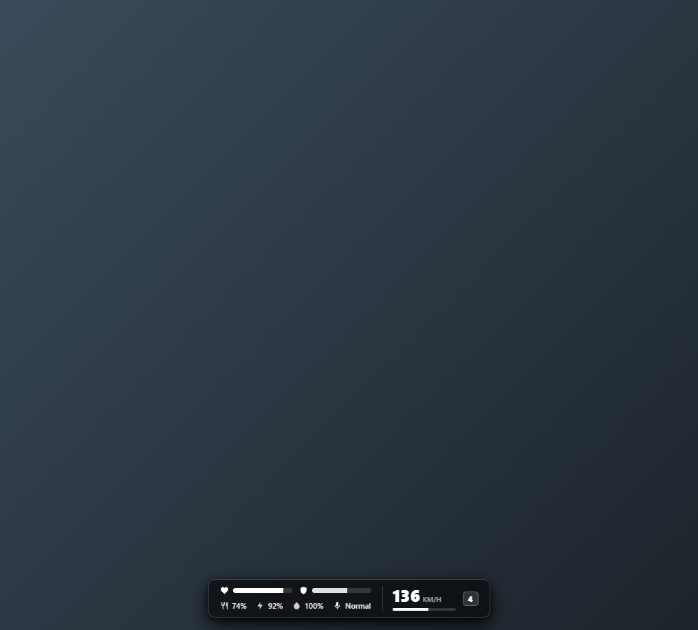

# hirx_hud

[Español](#espanol) | [English](#english)

---

## Capturas / Screenshots

### Estilo 1 — Minimal (`minimal`)



### Estilo 2 — Rings (`rings`)



### Estilo 3 — Tactical (`tactical`)



---

<a id="espanol"></a>

## Español

HUD minimalista para FiveM a juego con **hirx_streets** (fondo negro semitransparente, iconos/barras en blanco y `box-shadow` negro), con **3 estilos intercambiables**, soporte para **ESX**, **QBCore / QBX** y **pma-voice**.

### Indicadores incluidos

- **Vida**, **Armadura**, **Comida**, **Stamina**, **Oxigeno**
- **Voz (`pma-voice`)**: indicador activo al hablar y rango actual (`Susurro`, `Normal`, `Grito`)
- **Velocimetro**: velocidad en `KM/H` o `MPH`, marcha actual y barra/arco dinamico dentro de vehiculos

### 3 estilos elegibles

- `1` (`minimal`): Capsula horizontal minimalista abajo izquierda + velocimetro rectangular abajo derecha.
- `2` (`rings`): Anillos circulares individuales abajo izquierda + velocimetro en arco abajo derecha.
- `3` (`tactical`): Dock tactico simetrico en la parte inferior central.

La eleccion del jugador se guarda automaticamente en KVP.

### Instalacion

1. Coloca la carpeta `hirx_hud` dentro de `resources`.
2. Añade `ensure hirx_hud` en tu `server.cfg`.
3. Ajusta `Config.Framework` (`'auto'`, `'esx'`, `'qbcore'`, `'standalone'`) y `Config.DefaultStyle` en [`config.lua`](config.lua).

### Comandos y Exports

- `/hudestilo [1|2|3]` (o sin argumentos para rotar entre los 3 estilos)
- `/hud` para ocultar/mostrar el HUD

```lua
exports['hirx_hud']:SetHudStyle('rings') -- 'minimal' | 'rings' | 'tactical'
exports['hirx_hud']:GetHudStyle()
exports['hirx_hud']:SetHudVisible(false)
exports['hirx_hud']:SetHunger(80)
```

### Licencia

Este proyecto esta bajo la licencia [MIT](LICENSE).

---

<a id="english"></a>

## English

Minimalist FiveM HUD designed to match **hirx_streets** (translucent black background, white accents, and black `box-shadow`), featuring **3 selectable layouts** and built-in compatibility with **ESX**, **QBCore / QBX**, and **pma-voice**.

### Included Indicators

- **Health**, **Armor**, **Hunger**, **Stamina**, **Oxygen**
- **Voice (`pma-voice`)**: live talking indicator and proximity range (`Whisper`, `Normal`, `Shout` configurable in `config.lua`)
- **Speedometer**: `KM/H` or `MPH`, current gear, and progress bar/arc when inside a vehicle

### 3 Selectable Styles

- `1` (`minimal`): Minimal horizontal pill (bottom-left) + rectangular speedometer (bottom-right).
- `2` (`rings`): Circular progress rings (bottom-left) + arc speedometer (bottom-right).
- `3` (`tactical`): Symmetrical bottom-center tactical dock.

Player preference is automatically saved via KVP.

### Installation

1. Place the `hirx_hud` folder inside your `resources` directory.
2. Add `ensure hirx_hud` to your `server.cfg`.
3. Configure `Config.Framework` (`'auto'`, `'esx'`, `'qbcore'`, `'standalone'`) and `Config.DefaultStyle` in [`config.lua`](config.lua).

### Commands & Exports

- `/hudestilo [1|2|3]` (or no arguments to cycle through all 3 styles)
- `/hud` to toggle HUD visibility

```lua
exports['hirx_hud']:SetHudStyle('rings') -- 'minimal' | 'rings' | 'tactical'
exports['hirx_hud']:GetHudStyle()
exports['hirx_hud']:SetHudVisible(false)
exports['hirx_hud']:SetHunger(80)
```

### License

This project is licensed under the [MIT](LICENSE) License.
